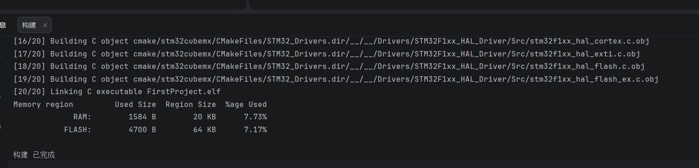

# 电控组首次培训作业

- **李青霖**
- ***20263005044***

---

## 一、工程概况

| 项目 | 内容 |
| --- | --- |
| 目标芯片 | STM32F103C8T6（LQFP48，Cortex-M3） |
| 开发板 | STM32F103C8T6 最小核心板 |
| 工程生成 | STM32CubeMX 6.15.0 |
| 固件包 | STM32Cube FW_F1 V1.8.7 |
| 交叉编译器 | arm-none-eabi-gcc 10.3.1（GNU Arm Embedded Toolchain 10.3-2021.10） |
| 构建系统 | CMake 4.3.1 + Ninja 1.13.2 |
| IDE | CLion 2026.2.2 |
| 调试器 | OpenOCD 0.12.0 + ST-Link（SWD） |

## 二、CubeMX 关键配置

| 配置项 | 取值 |
| --- | --- |
| RCC → HSE / LSE | 均为 `Crystal/Ceramic Resonator`（外部晶振） |
| SYS → Debug | `Serial Wire`（SWD 两线调试，PA13/PA14） |
| Clock Configuration | SYSCLK = **72 MHz**：HSE 8 MHz × PLL9；AHB ÷1、APB1 ÷2 = 36 MHz、APB2 ÷1 = 72 MHz |
| Project Manager → Toolchain | CMake |
| Code Generator | 外设初始化按 .c/.h 成对生成；保留用户代码段 |
| 板载 LED | PC13 → `GPIO_Output`，标签 `LED`（低电平点亮） |

时钟树核对（CubeMX 生成的 `SystemClock_Config()`）：

```c
RCC_OscInitStruct.OscillatorType = RCC_OSCILLATORTYPE_HSE;
RCC_OscInitStruct.HSEState       = RCC_HSE_ON;
RCC_OscInitStruct.PLL.PLLState   = RCC_PLL_ON;
RCC_OscInitStruct.PLL.PLLSource  = RCC_PLLSOURCE_HSE;
RCC_OscInitStruct.PLL.PLLMUL     = RCC_PLL_MUL9;      /* 8 MHz × 9 = 72 MHz */
RCC_ClkInitStruct.SYSCLKSource   = RCC_SYSCLKSOURCE_PLLCLK;
RCC_ClkInitStruct.AHBCLKDivider  = RCC_SYSCLK_DIV1;   /* HCLK  = 72 MHz */
RCC_ClkInitStruct.APB1CLKDivider = RCC_HCLK_DIV2;     /* PCLK1 = 36 MHz */
RCC_ClkInitStruct.APB2CLKDivider = RCC_HCLK_DIV1;     /* PCLK2 = 72 MHz */
```

## 三、编译结果

编译命令：

```bash
cmake --preset Debug          # 配置
cmake --build --preset Debug  # 编译
```

编译日志（末尾）：

```text
[17/20] Building C object cmake/stm32cubemx/CMakeFiles/STM32_Drivers.dir/__/__/Drivers/STM32F1xx_HAL_Driver/Src/stm32f1xx_hal_exti.c.obj
[18/20] Building C object cmake/stm32cubemx/CMakeFiles/STM32_Drivers.dir/__/__/Drivers/STM32F1xx_HAL_Driver/Src/stm32f1xx_hal_flash_ex.c.obj
[19/20] Building C object cmake/stm32cubemx/CMakeFiles/STM32_Drivers.dir/__/__/Drivers/STM32F1xx_HAL_Driver/Src/stm32f1xx_hal_flash.c.obj
[20/20] Linking C executable FirstProject.elf
Memory region         Used Size  Region Size  %age Used
             RAM:        1584 B        20 KB      7.73%
           FLASH:        4700 B        64 KB      7.17%
```

编译成功截图：



> 验收要点：链接完成（`Linking C executable FirstProject.elf`）且生成 `FirstProject.elf`，Flash 占用 4700 B / 64 KB，RAM 占用 1584 B / 20 KB。

## 四、点灯代码

在 `Core/Src/main.c` 的 `USER CODE` 段内编写（重新生成代码时不会被覆盖）：

```c
/* USER CODE BEGIN 2 */
HAL_GPIO_WritePin(LED_GPIO_Port, LED_Pin, GPIO_PIN_SET);  /* 上电先熄灭 */
/* USER CODE END 2 */

  /* USER CODE BEGIN 3 */
  HAL_GPIO_TogglePin(LED_GPIO_Port, LED_Pin);   /* PC13 每 500 ms 翻转 */
  HAL_Delay(500);
  /* USER CODE END 3 */
```

## 五、目录结构

```text
FirstProject/
├─ FirstProject.ioc              # CubeMX 工程文件（芯片/时钟/引脚配置都在这里）
├─ CMakeLists.txt                # CubeMX 生成的 CMake 工程入口
├─ CMakePresets.json             # Debug / Release 预设
├─ STM32F103XX_FLASH.ld          # 链接脚本（已删除 GCC10 不支持的 (READONLY) 关键字）
├─ startup_stm32f103xb.s         # 启动文件
├─ Core/                         # 用户代码：main.c / gpio.c / 中断 / HAL MSP
├─ Drivers/                      # CMSIS + STM32F1xx HAL 驱动
├─ cmake/                        # 交叉编译工具链文件、stm32cubemx 源文件清单
└─ images/build-success.png      # 编译成功截图
```

## 六、如何复现

1. 安装 CLion，工具链指向 arm-none-eabi-gcc（10.3.1）。
2. 确认 `arm-none-eabi-gcc` 在系统 PATH 中（CubeMX 的 CMake 工具链文件靠 `arm-none-eabi-` 前缀找编译器）。
3. 在本目录执行：

```bash
cmake --preset Debug
cmake --build --preset Debug
```

4. 产物：`build/Debug/FirstProject.elf`（可用 `arm-none-eabi-size build/Debug/FirstProject.elf` 复核占用）。

> 注：若使用 GCC 10 及更早版本，链接脚本里的 `(READONLY)` 关键字会报
> `non constant or forward reference address expression`，需删除（本工程已处理）。
